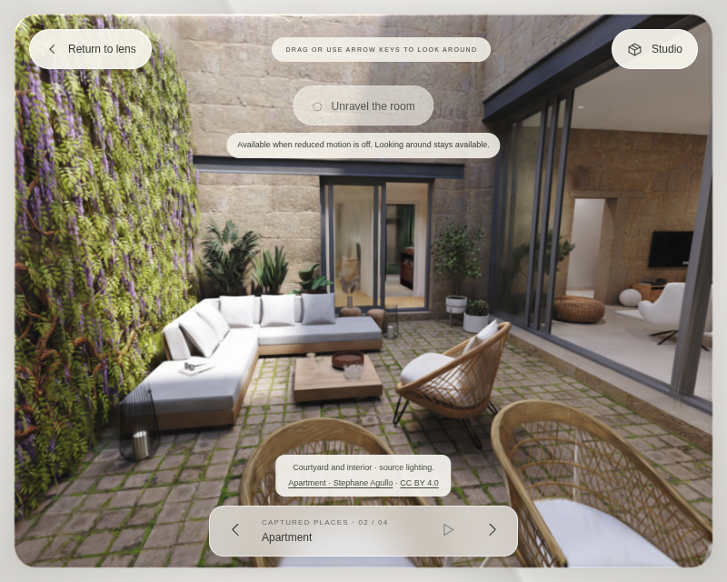
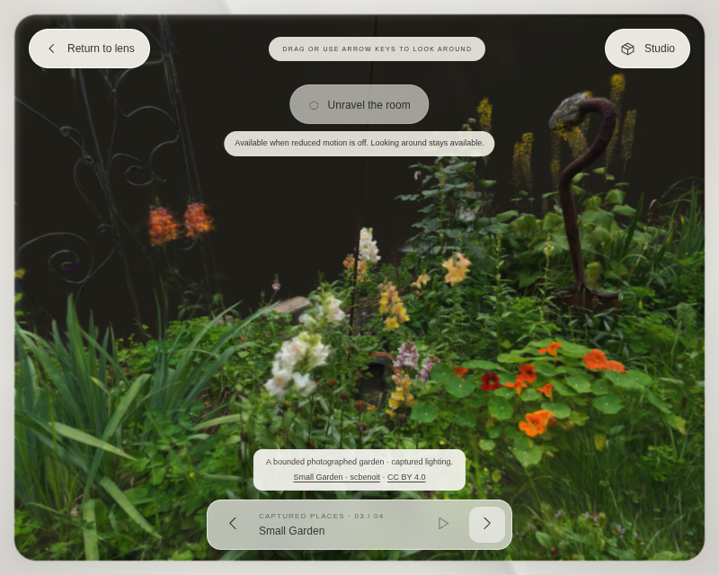
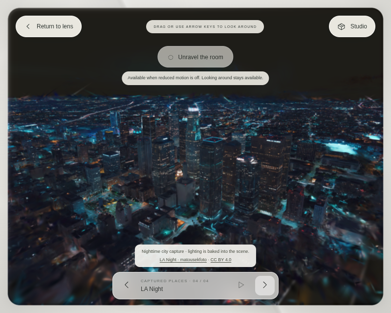

# FORM: captured scene collection

The default room collection is now **Pantheon, Apartment, Small Garden, and LA Night**. Apartment, Small Garden and LA Night replace Limestone, Nocturne and Veil in the main navigation and Media gallery. The previous authored rooms remain in a separate **Authored studies · threshold experiment** link, so the geometric doorway experiment is still available.

Start with `?room=1&space=apartment&renderer=webgl` to see the new apartment courtyard. Enter the lens for the expanded view. Previous/Next changes scenes; Studio → Media shows four actual scene thumbnails, sizes, creators, and source/license links. Unravel uses the same deliberate hold/drag/release interaction in all four captures. Reduced motion keeps deliberate looking available and disables deformation.

## Assets and provenance

All four assets have asset-specific CC BY 4.0 credit evidence. The original SuperSplat pages were inaccessible from this environment; the evidence used here is the explicit attribution alongside each mirrored file or the official PlayCanvas example that names and loads it. An application's code license is never used as a substitute for scene rights.

| Scene | Creator / source | Bytes | Splats | Source and changes |
| --- | --- | ---: | ---: | --- |
| Pantheon | [artfletch](https://superspl.at/scene/dac6e508) | 10,577,976 | 700,000 | Existing Oculo mirror. Source reduced from ~4M, SH degree 1, NaNs removed and SOG re-encoded. Original creator reconstructed the floor; this remains a hybrid reconstruction. |
| Apartment | [Stephane Agullo, SA3D_R&D_XP47](https://superspl.at/view?id=cdcec084) | 8,379,050 | 661,466 | Unchanged `examples/assets/splats/apartment.sog` from PlayCanvas. The official editor and paint examples explicitly credit the scene under CC BY 4.0 and load that file. The view shows a courtyard and adjoining interior. Its original capture method is not independently verified; FORM does not label it a surveyed or documentary photograph. |
| Small Garden | [scbenoit / SteveB](https://superspl.at/scene/108dd868) | 13,081,550 | 689,694 | Oculo's SOG packages unchanged original component bytes, with SH degree 3. This is a bounded planted garden, not a large navigable landscape. |
| LA Night | [matousekfoto](https://superspl.at/scene/d1ea0b35) | 10,784,806 | 700,000 | Oculo mirror, reduced from 2,994,000 splats, SH degree 1, NaNs removed and SOG re-encoded. The starting view is an aerial nighttime skyline. |

License: [Creative Commons Attribution 4.0](https://creativecommons.org/licenses/by/4.0/). Each scene's SOG digest, byte count, source repository/revision, creator, source URL and changes are recorded in `public/captures/<id>/PROVENANCE.json`. Preserve the adjacent attribution text and `THIRD-PARTY-LICENSES.txt` when redistributing.

Pinned source repositories:

- [Oculo, 2543e2388671f6d5252acd60357abcb5a5ec0895](https://github.com/skylarhknight/Oculo/tree/2543e2388671f6d5252acd60357abcb5a5ec0895/apps/mobile/public/scenes): Small Garden and LA Night, plus the existing Pantheon.
- [PlayCanvas engine, 3465f3ebe2ca19d53c7e0b853fc129af20df5811](https://github.com/playcanvas/engine/tree/3465f3ebe2ca19d53c7e0b853fc129af20df5811/examples/assets/splats): Apartment. Asset-specific credit and camera/transform evidence are in [editor.example.mjs](https://github.com/playcanvas/engine/blob/3465f3ebe2ca19d53c7e0b853fc129af20df5811/examples/src/examples/gaussian-splatting/editor.example.mjs) and [paint.example.mjs](https://github.com/playcanvas/engine/blob/3465f3ebe2ca19d53c7e0b853fc129af20df5811/examples/src/examples/gaussian-splatting/paint.example.mjs).

The apartment thumbnail is rendered from FORM's own view of the credited scene. The other thumbnails retain the upstream credited views. FORM preserves SOG bytes and applies orientation, camera framing, bounded motion and optional reversible deformation at runtime.

## Camera and loading

Every scene carries its own position, target, vertical FOV, object quaternion, scale and translation. The apartment uses the example's 180-degree X rotation, half scale and translated object, rather than Pantheon's 180-degree Z rotation. Its example camera is retained with a narrower 75-degree vertical FOV. Garden and LA Night use their published camera targets and the SuperSplat orientation. These are intentionally bounded viewing positions, not unrestricted walking with collision or unseen reconstructed surfaces.

All files are self-hosted with the site. Only a selected SOG is downloaded, into a size-limited buffer verified against its pinned SHA-256. The active scene remains visible while a replacement prepares. A failed replacement keeps that scene and exposes the failed scene's credit and Retry action; retry targets the failed asset, rather than redownloading the retained one. An initial failure displays an honest unavailable state. A newer choice aborts pending downloading; superseded decoded candidates are disposed. Initial loading can also be superseded by another captured scene.

The resident bound is one active capture plus at most one candidate during a switch. Disposing the outgoing capture releases its Spark resources, renderer and graphics context. Module/decoder infrastructure stays cached. Navigation and sorting use the existing application clock; no extra application animation loop is introduced.

The opt-in Play rooms sequence now visits these four scenes in order. Downloading and room blending pause its 14-second viewing dwell. Playing the entire collection can download **42,823,382 bytes** of scene data in total, before code and thumbnails. There is no background download of all four on entry.

## Authored studies and delivery

`?room=1&studies=1&space=gallery` opens the old authored collection with its threshold controls. Existing links that explicitly name gallery/nocturne/veil or request the threshold experiment still open that view. Captures do not display a false geometric threshold control: their alpha-sorted splats need a dedicated depth/portal integration.

The production build retains lazy Spark code and per-scene assets. Publish all of `dist/`. The optional single-file exporter embeds all four captures and thumbnails so it is much larger (about 61 MB); only the selected scene is decoded. It is an offline edition, not the primary deployment bundle. PNG exports retain the credited asset's CC BY attribution requirements when redistributed.

Unit tests pin all four assets, their credits, counts, and finite playlist. Browser coverage exercises the public collection, individual lazy loading, failed replacement/retry, initial-loading cancellation, all three new scenes' rendered pixels and exact Unravel restoration, mobile touch/rotation, and the retained authored threshold study. Physical-device GPU performance remains unmeasured.

## Rendered views

These are screenshots of the production build, with the scene's credit retained in the interface.

See [the validation record](collection-validation-results.json) for checks and delivery measurements.
