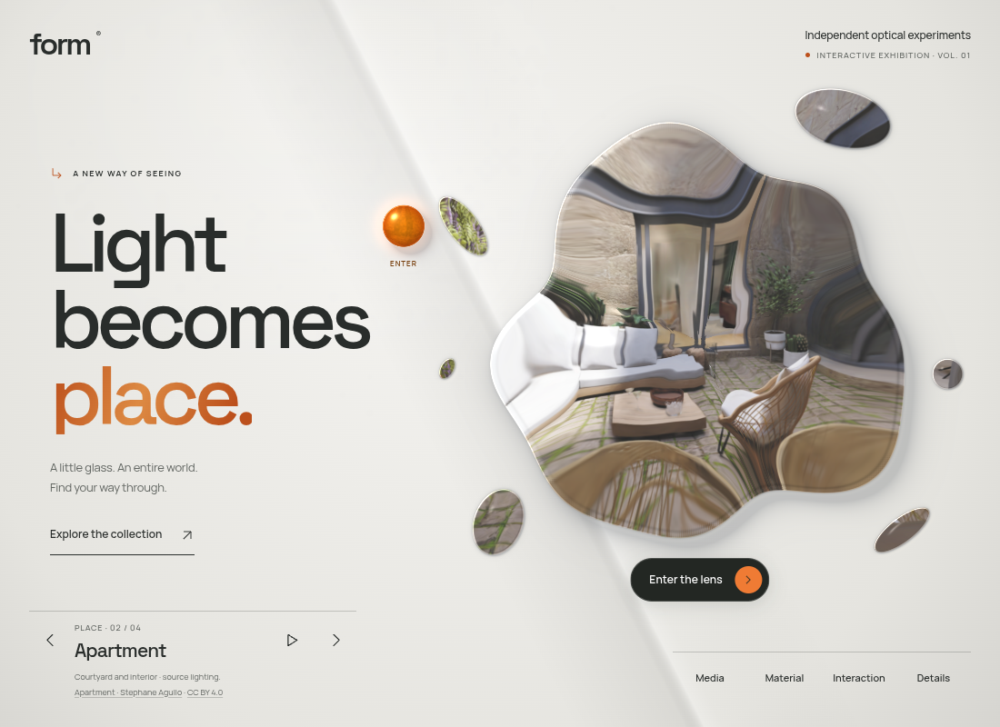
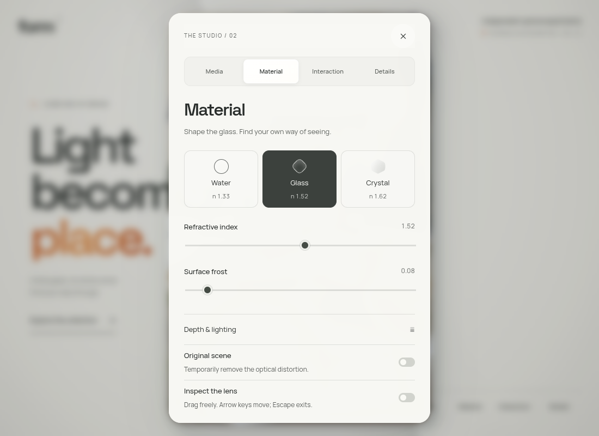
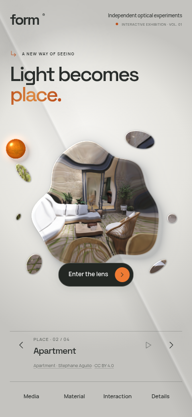
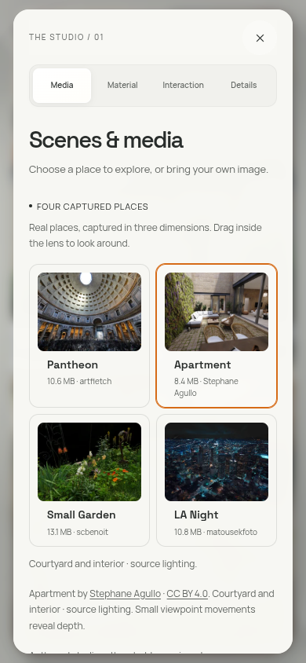

# Motion through FORM

This is the preceding motion release. The current [minimal exhibition](MINIMAL-EXHIBITION.md) changes the headline to two words, replaces the font pair, and uses an underline for the selected studio section. The earlier preview and validation below remain historical.

The exhibition uses masked word reveals, a sliding studio marker, and direction-aware panel entrances. Motion follows the existing warm glass presentation. The room, optical rendering and typography retain their established composition.

[Open the live preview](https://rawcdn.githack.com/ejaubashi/vvv/fc5c8374d6d3048093a949f8081958066dffd06f/preview/index.html?room=1&space=apartment&renderer=webgl).

## Titles and navigation

The three exhibition words rise through individual masks with a small perspective turn and a 75 ms stagger. On desktop, a pointer over the title produces up to four pixels of layered movement and shifts a restrained warm highlight in “place.” The words return to rest when the pointer leaves. Word wrappers retain the actual text, spaces and font kerning; there are no duplicate text layers or scrambled characters.

The studio dock has a moving accent rail shared by pointer and keyboard focus. Labels lift and reveal their section numbers. The active section inside the dialog travels as one light surface beneath four stationary buttons. Press feedback uses the individual CSS scale property, preserving the positioning transforms on fixed controls. Room captions reveal once when the selected place changes.

## Studio sections

The optical lens still expands into the studio. A reveal callback starts the title and control rows when the surface is nearly expanded. Switching sections updates the content immediately: titles enter through word masks, rows arrive with a short stagger, and the direction follows the section order. The longest panel score is 690 ms. The initial exhibition title finishes within 1.05 seconds; return-to-lens uses a shorter score.

Rapid changes cancel the previous effects and retain the newest content. There are no delayed content replacements, DOM snapshots of form controls, or focus transfers to decorative titles. Existing material values, dialog containment, close behavior and return focus remain available throughout.

## Implementation and access

`src/exhibition-motion.ts` owns finite Web Animations effects and event listeners. `src/exhibition-motion.css` handles masked typography, the two navigation indicators and hover details. Completed effects release their fill state. Pointer writes are coalesced into one requested frame per movement; there is no persistent DOM animation loop or new dependency. The existing optical animation clock remains separate.

System and application reduced motion cancel active scores and restore visible, stationary content. Touch gets press feedback without pointer-driven title movement. Hidden documents settle their effects; page teardown aborts listeners and cancels pending work. Without the Web Animations API, headings and sections remain functional. Forced-colors styles retain visible text and selection indicators.

## Verification

The current release checks 13 browser cases covering rapid section changes, retained values, keyboard/touch focus, dynamic system and application reduced motion, missing animation API, idle rendering, and room entry/return through WebGL and WebGPU. 55 production layout checks cover all four sections at nine viewport sizes, short and landscape screens, sticky close controls, touch targets, and a font fallback. The standalone export loads its embedded fonts without external requests.

The Apartment courtyard is reviewed in the built website on desktop and phone. The production check observes native section effects, waits for them to settle, and verifies both reduced-motion paths. See [the validation record](exhibition-motion-validation-results.json). Graphics checks use software Chromium; physical-device frame time is unmeasured.

