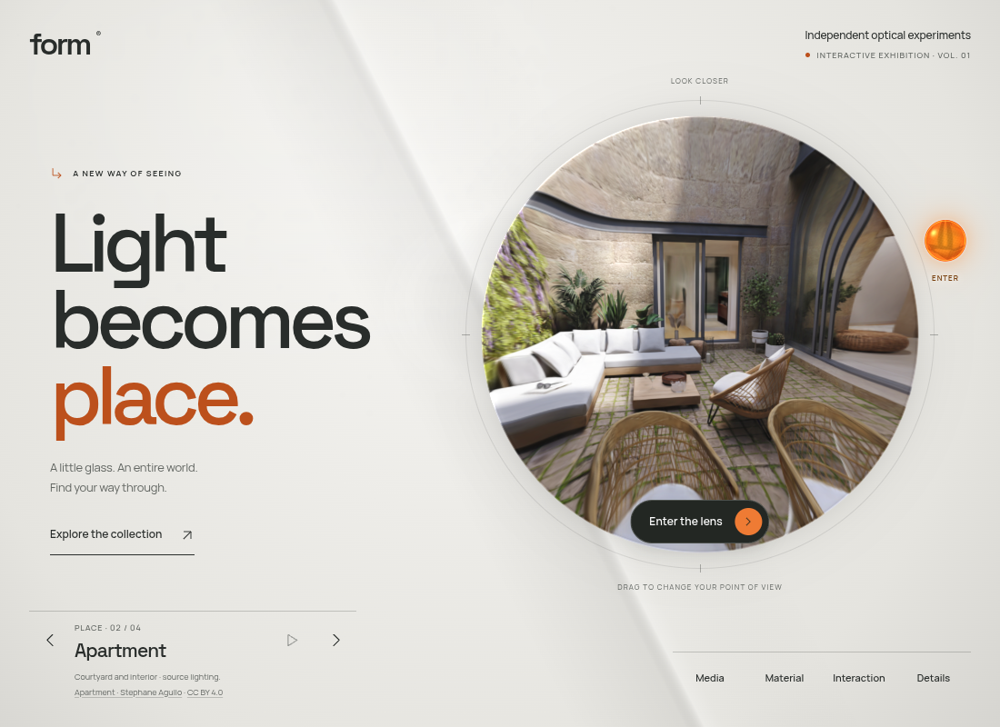
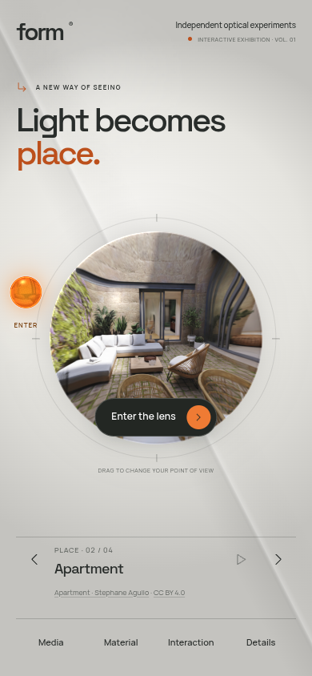

# FORM: a spatial exhibition

Research and implementation, 23 October 2026. The design problem is distinction: a small lens in the middle of a large gray stage, with utility controls around it, reads as a tool demonstration. FORM needs a recognizable composition, a reason to enter, and a transition that delivers on that invitation.

[Try the exhibition preview](https://rawcdn.githack.com/ejaubashi/vvv/4217bf882cdd3a0a7ef9e2815f3b5ca69b915ae4/preview/index.html?room=1&space=apartment&renderer=webgl).

## Case studies and evidence

| Reference | Evidence inspected | Useful principle for FORM |
| --- | --- | --- |
| [Lusion — original WebGL/DOM study](https://github.com/lusionltd/WebGL-Scroll-Sync) | Official studio README and CSS. The README calls its own site award-winning; the public study had 379 GitHub stars when checked. This is evidence of studio authorship and developer interest, not measured visitor conversion. | Treat type and the rendered object as one composition. The source uses a strong display face and a decisive size hierarchy. Keep interaction synchronized with the visual surface. |
| [Codrops — Image Expansion Typography](https://github.com/codrops/ImageExpansionTypography) | Original README and layout CSS; 47 stars. An expanding image is composed within typography. This is an editorial experiment, not a commercial performance claim. | Give the image a relationship to the headline. Its expansion should reveal a new content level instead of adding an unrelated effect. |
| [Codrops — Kinetic Typography Page Transition](https://github.com/codrops/KineticTypePageTransition) | Original README and CSS; 127 stars. The README describes background letters revealing a new content level. This is an established study, not a newly released 2026 feature. | Typography can establish anticipation, then recede when the visitor reaches the content. Use a finite introduction and an explicit entry action. |
| [Interlude](https://github.com/codrops/interlude) | Original README and entrance source pinned to its 7 October 2026 revision; 42 stars. | Choreography needs lifecycle and focus handling. Keep content useful after the transition, preserve keyboard return, and load costly rendering only when needed. FORM already has its own entrance clock, so no Astro or GSAP migration is needed. |
| [Atelier North](https://github.com/codrops/atelier-north) | Original architecture template README and page source pinned to 9 October 2026; 9 stars. A recent fictional-studio showcase, not an established commercial success. | Large architectural type, a deliberate grid, and a small supporting information layer create identity without filling every area with controls. |

The [source receipt](research-exhibition-sources.json) records repository revisions, file hashes, author links, dates, and observed adoption counts. Public Awwwards, Lusion, Igloo, Unseen, and Active Theory pages returned proxy CONNECT 403 here. Their live experiences were not audited. No current award ranking, analytics, conversion rate, or newly launched feature is inferred from those blocked pages.

## Original direction implemented

**Light becomes place.** A large three-line editorial heading gives FORM an identity and explains the spatial premise. The desktop lens is larger and offset beside the heading. Phones use a compact two-line title and a centered lens; short screens prioritize the object and controls. The earlier utility layout remains available inside the studio.

Space Grotesk supplies a distinct display rhythm, paired with Manrope for supporting controls. Rust-orange type relates to the solar object, with fine framing marks and clear whitespace around the lens. The collection and studio use a lighter typographic rail instead of two competing floating cards. The existing optical rendering and captured-room attribution remain intact.

The collection can be opened directly from the introductory composition. Closing it restores focus to that trigger. Entering the lens clears the introduction and framing marks so looking around becomes the primary activity. Material inspection also clears the introduction. A short, finite text reveal settles; reduced motion removes it. There is no new idle animation loop, rendering framework, runtime dependency, stock image, or remote font service.

This is an original application of composition and choreography principles. No external study's code, images, proprietary branding, or layout assets were copied. The original self-hosted Space Grotesk Latin variable font is distributed under OFL 1.1, with provenance and the full notice in `public/fonts`.

## Review

See [exhibition validation](exhibition-validation-results.json) for the production build, responsive and interaction review, portable export, captured-room screenshots, and publication verification. Source inspection informs the design; it does not prove that this direction will increase retention. That requires visitor feedback and measured use after publication.

