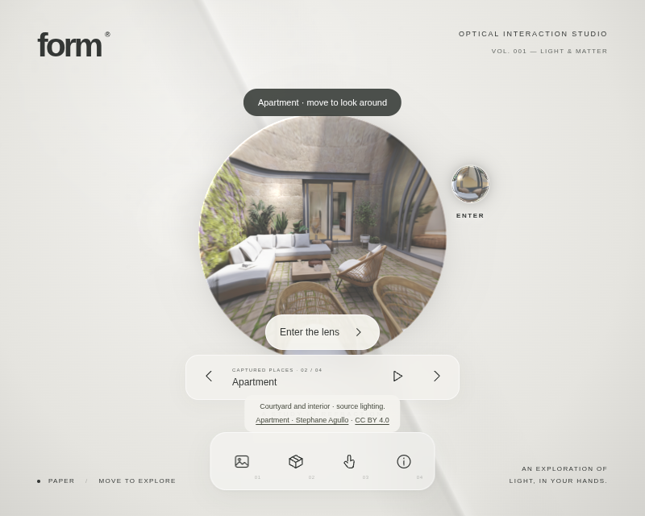
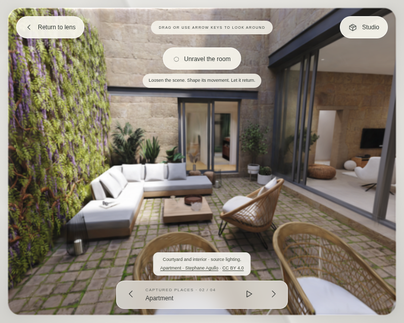

# FORM: enter through a glass object

Click the small glass object beside the lens, or use the existing **Enter the lens** button. The object approaches the glass, stretches, sinks through its surface, and sends a refractive ripple across the room. The lens then opens into the expanded room view. The room remains visible throughout the transition.

The entrance uses a finite 1.4-second animation score after the selected room is ready and visible. Downloading and initialization happen before the score begins; the Return control and Escape remain available while waiting. The animation advances on the existing application clock, pauses in a hidden tab, and stops drawing once the view settles. Slow devices can take longer to present the sequence.

## Rendering and interaction

The object samples the room image rather than displaying a separate stock texture. WebGL and WebGPU render its refraction, highlight, rim, and contact distortion in the optical compositor. The ripple displaces samples of the room image; it does not deform the underlying captured architecture. Canvas 2D retains the object, entrance, and an illustrated contact ring without claiming equivalent optical refraction.

One entrance score drives the expanding frame and room camera. Room navigation, sculpting, threshold controls, and studio panels wait until entry finishes. Capture downloads, creators, attribution, camera coverage, and the existing authored/captured renderer separation remain as documented in [Captured collection](CAPTURED-COLLECTION.md).

Both entry controls work with the keyboard. The glass object has a 60-pixel touch target and moves to the available side of the lens on narrow screens. Escape interrupts the approach, contact, expansion, or loading. Return reverses the existing expansion spring and restores focus to the control used to enter. A new visit starts a fresh score, and a cancelled asynchronous initialization cannot reopen the view.

Reduced motion skips approach, distortion, and expansion. Changing the preference during entry completes it immediately. Deliberate looking and Return remain available.

The subtle contact tone plays only when the existing sound demonstration is enabled. It uses that audio context and connects through the same analyser. Disabling sound, returning, hiding the tab, or disposing the app disconnects the cue. No audio asset or new runtime dependency is downloaded.

## Validation

Unit coverage checks room visibility before launch, a single contact event, exact completion, cancellation/replay, reduced motion in flight, bounded object placement, and finite temporary distortion. Browser coverage checks the actual WebGL pixel displacement and exact restoration, WebGPU presentation, narrow-screen touch, keyboard focus, cancellation/replay, the optional audio lifecycle, and idle rendering.

The full regression suite also covers the four captures, Unravel restoration, authored thresholds, studio dialogs, export, and renderer fallback. Automated GPU checks use Chromium software rendering; physical desktop/mobile frame rate remains unmeasured.

Run `npm test`, `npm run test:browser`, and `npm run build`. The nested production path and real Apartment capture are checked with `node scripts/check-entrance-deployment.mjs`.

