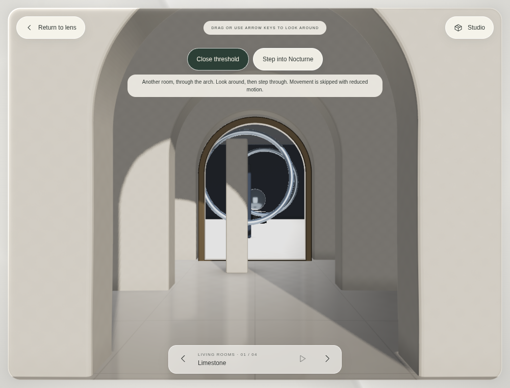
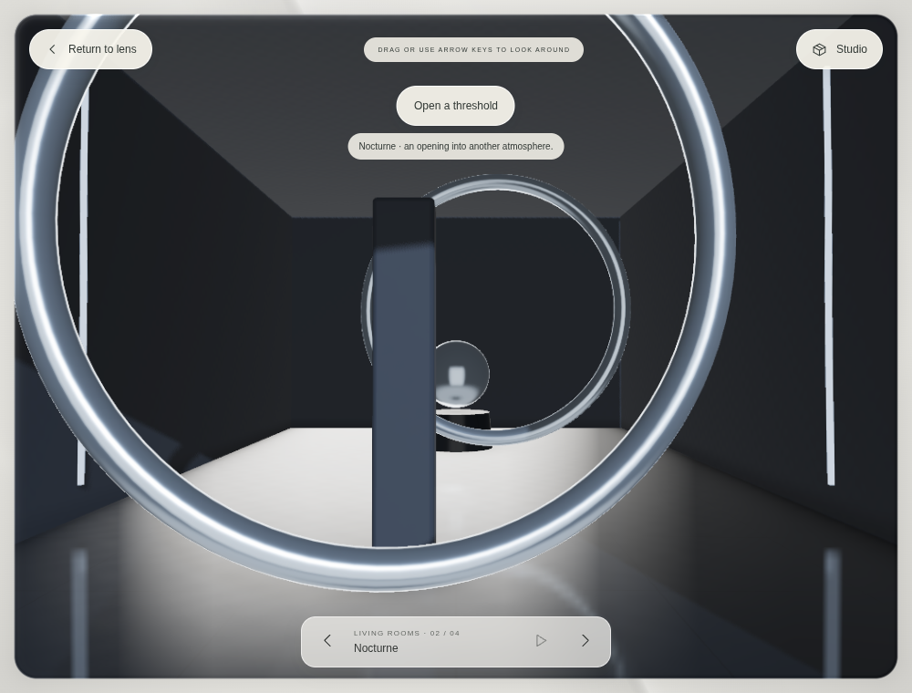

# Impossible thresholds

An arch in Limestone can now contain a live view into Nocturne. Moving the viewpoint changes the view beyond the opening, and the existing foreground column obscures it. **Step into Nocturne** approaches the doorway and adopts that already-prepared room. The route continues Nocturne → Veil → Limestone. Nothing crosses automatically.

## Visit

Enter the lens, then choose **Open a threshold**. Look around by dragging or using the arrow keys. Choose **Step into …** to cross. **Close threshold** or Escape cancels the opening/approach; a subsequent Escape returns to the lens. Reduced motion performs the same deliberate crossing without the approach animation. Studio, return, another room selection, document hiding and disposal close the opening. A cancelled preparation cannot reattach later.

The optional `?room=1&space=gallery&threshold=1&renderer=webgl` entry URL prepares the opening when Enter the lens is chosen. The standard URL exposes the feature as an opt-in control in any of the three authored rooms. Captured Pantheon and architectural-illustration fallback do not display a control for an unsupported opening.

## Spatial rendering

`RoomThreshold` owns one destination graph and one nonrecursive render target. Its aperture is a depth-tested, arched 3D mesh with an extruded metal jamb. Source geometry in front of that plane participates in ordinary depth testing. Destination geometry is rendered with a translated copy of the source camera, keeping the same orientation and horizontal/vertical projection. A world-space entrance plane replaces the destination's near plane using an oblique projection. Both WebGPU's zero-to-one and WebGL's minus-one-to-one depth conventions are handled explicitly.

Both rooms retain their existing half-resolution floor-reflection pass, so an active opening also pays for the destination's reflection. The portal material derives projective texture coordinates from camera-space position. The target has the same aspect as the source and a long edge capped at 1024 pixels. An unsigned-byte sRGB intermediate and a non-tone-mapped aperture keep the destination display transform from being applied twice. Visual inspection caught missing metallic detail with an earlier half-float intermediate; the browser check reads the actual target and requires visible highlights on Nocturne's rings.

The approach is finite, uses the existing application's clock, and caps the source view at a 768-pixel long edge while moving. It centers the visitor in the doorway rather than permitting arbitrary free walking through the column. On crossing the destination model and surfaces transfer to the main room; the old source and portal resources are disposed. A retained camera offset preserves the arrival viewpoint. Manual room selection resets that offset. The route is finite per crossing, requires another explicit opening, and does not retain a chain of old scenes.

Preparation is cancellable through a generation token. Renderer compilation itself cannot be aborted, so cancelled candidate resources are disposed after compilation settles. Room changes wait for that task before compiling another replacement. Closing an already-closed threshold is a no-op: routine Studio and room actions do not trigger an extra 3D redraw. There is no additional animation loop, runtime package, external asset host or automatic capture download.

## Limits

This first experiment connects authored spaces. It does not insert a traversable hole into the Pantheon reconstruction. Captured portals need splat/depth integration and supporting proxy geometry; the research compares Spark's current portal implementation with a future native Three splat adapter.

Source and destination have independent authored lighting; light does not physically travel through the opening. The source's existing floor reflection is an approximation and does not provide recursive portal reflections. There is one opening, with no recursive portal nesting, free-roam collision solver, volumetric light transport or networked world. Bounded parallax and the doorway view are actual 3D rendering.

## Validation

See `threshold.test.ts`, `tests/browser/threshold.spec.ts` and [the validation record](threshold-validation-results.json). 27 unit checks and 54 distinct browser cases passed across the final targeted runs, plus normal and portable deployment checks. Checks cover view-ray alignment and clipping in both depth conventions, real foreground ray occlusion, deliberate finite approach/reduced motion, visible pixel changes and metallic detail, idling, destination adoption, cancellation/disposal, keyboard and touch controls, rotation, fallback and actual WebGPU rendering in software Chromium.

Software GPU timing is not a physical-device performance measurement. Existing Details continues to report CPU submission time, not GPU duration. Production and portable builds are also checked from a nested preview path before publishing.

The wider source-grounded study is [Beyond modern research, 22 October 2026](BEYOND-MODERN-RESEARCH-2026-10-22.md).
