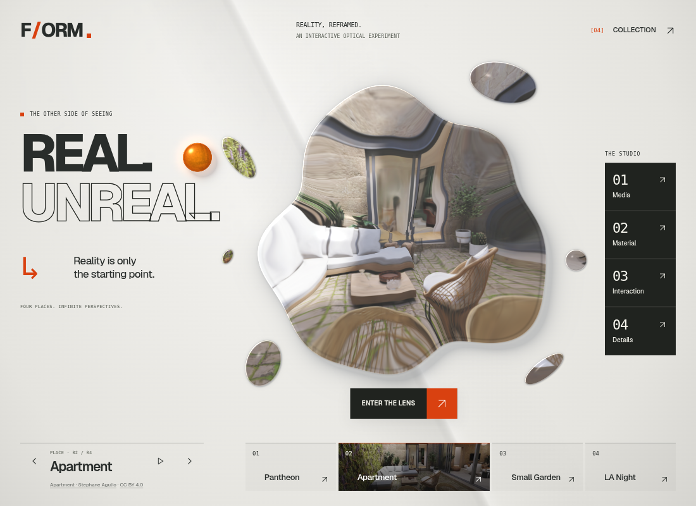
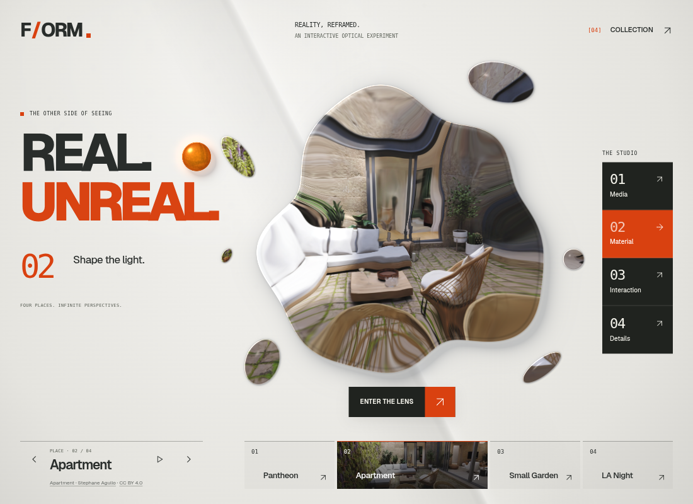
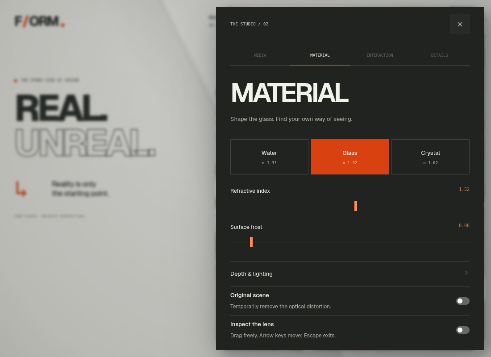
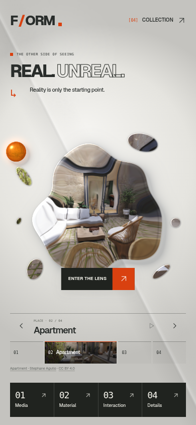
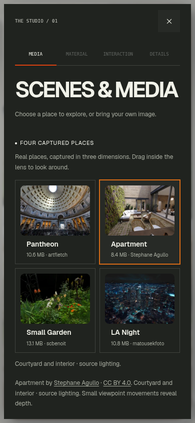

# REAL. UNREAL. — FORM as an optical instrument

This release replaces the preceding “Look closer.” editorial layout with a stronger, interactive composition: heavy variable typography, outlined lettering, a vertical command index, an expanded scene strip and a dark studio aligned to the screen edge.

[Open the desktop and phone preview](https://rawcdn.githack.com/ejaubashi/vvv/c103629322b7c7f37173f9399a65beff2421c7dc/preview/index.html?room=1&space=apartment&renderer=webgl).

The glass moves toward the center of the desktop stage while the title occupies the left and the studio index sits on the right. Orange connects the entrance, selected controls and navigation. The sun reserves room for the index, keeping both controls reachable. On phones, the title becomes a single line and the studio becomes a four-part bottom rail. Short phones show the direct scene strip in place of the larger room-navigation row; landscape keeps the previous/next controls and Collection entrance.

## Interactions

- **Responsive type:** moving across the title changes the actual Geist variable-font weight as well as its existing bounded parallax. Leaving restores its resting state. It runs only in response to pointer input and is stationary under reduced motion.
- **Studio preview:** hover or keyboard focus fills the outlined “UNREAL.” with orange, replaces the arrow with the section number, and reveals its purpose. Click, Enter or a single touch opens that section. Leaving restores the default text.
- **Direct scene index:** select any of the four places from the home screen. The active place expands into a photographic card; desktop hover previews another thumbnail. Keyboard and touch use the same buttons and selection state. Rapid selections share the existing room-cancellation lifecycle, URL and gallery state. Thumbnails are about 99 KB in total; captured geometry still downloads only when selected.
- **Dark studio:** the lens opens into an edge-aligned panel with large uppercase headings, numbered navigation, orange selections and narrow vertical slider handles. Native title and section effects remain finite, interruptible and focus-safe. The panel surface matches the transition rather than flashing the previous light theme.

The fluid glass, six unequal fragments, aligned scene sampling, optical edges and shadows, sun entrance and room return remain. The wordmark points to the current document so the versioned preview and single-file edition keep their entry URL.

## Type, access and packaging

The current design uses one self-hosted, unmodified **Geist variable WOFF2**, 29,400 bytes, with the SIL Open Font License and [font provenance](../public/fonts/PROVENANCE.json). Instrument Serif remains in source history but is no longer loaded or emitted by this release. The small technical labels use the device's monospace font. No dependency was added.

Primary touch controls retain at least 44 × 44 CSS px targets. System/application reduced motion, forced colors, font failure, missing Web Animations API, native dialog containment, close controls and trigger-focus restoration remain supported. The single-file export embeds the thumbnails for the new scene strip as well as the Media gallery, avoiding local-file asset requests.

## Validation

The TypeScript/Vite build, formatting and diff checks pass. All 33 unit/simulation/provenance tests pass. Nine browser cases cover motion, keyboard/touch, entry/return and WebGPU. A final five-case exhibition suite also passes, repeating its four motion cases after final styling and adding direct scene selection, rapid replacement, URL consistency and gallery state.

Forty-five production layout states cover home and all four sections at nine viewport sizes, from 320 × 568 to 1920 × 1080. They check visible text/control collisions, viewport bounds, horizontal overflow, touch targets and sticky close access. Layout isolation uses Canvas and an authored-room fallback. Additional production checks cover blocked fonts, forced colors and the offline edition.

Separate desktop and emulated-phone reviews use the actual Apartment courtyard and explicitly verify both the optical WebGL 2 context and ready Spark scene. Screenshots record the home, purpose preview and studio. They also check native section effects, one-tap Collection and scene-index access, entry/return, focus restoration and both reduced-motion paths. See the [validation/publication record](instrument-exhibition-validation-results.json).

Checks use software Chromium; physical-device frame times and Safari/Firefox are unverified. The execution proxy blocks GitHack, so publication verification compares GitHub refs and every built-file hash with the reviewed local build.

