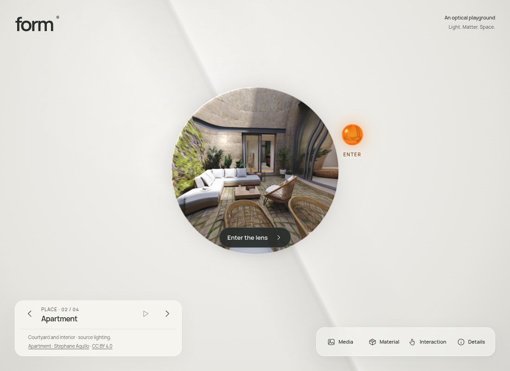
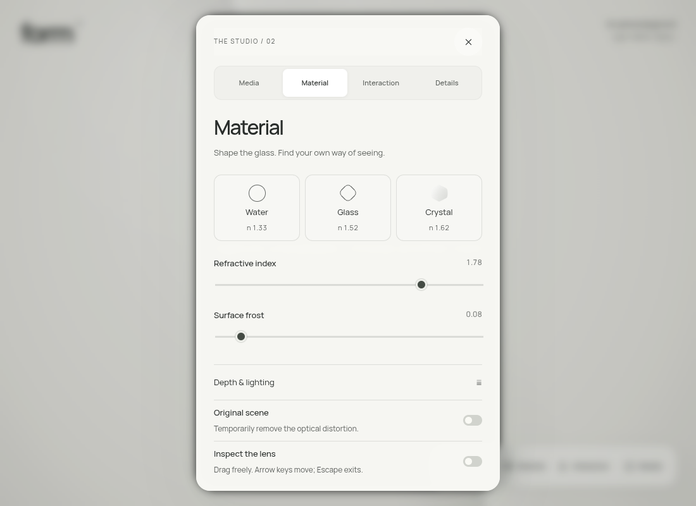
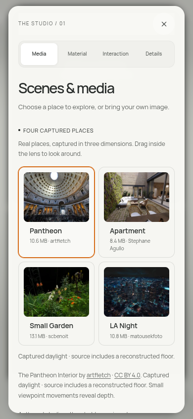

# FORM interface

The current presentation adds a larger, offset lens, editorial Space Grotesk typography, fine framing marks, and a direct collection shortcut. See [the exhibition research and current release](EXHIBITION-RESEARCH.md). The utility-system review and preview below record the preceding interface release; its studio switching and interaction improvements remain in use.

The lens and solar glass are the focus. A compact sans-serif identity and a restrained hierarchy replace the decorative serif treatment. The entrance button has a dark, clear action state. Controls wait for their first measured position before becoming visible.

[Open the current preview](https://rawcdn.githack.com/ejaubashi/vvv/1ac4e67f10beea62c1ced240ca1addc4643d53f9/preview/index.html?room=1&space=apartment&renderer=webgl).

## Navigation

Room navigation and creator credits form one collection panel, with explicit Previous, Next, and Play controls. On desktop it sits at the lower left; the labeled studio tools sit at the lower right. On portrait phones and tablets, these groups stack with a fixed gap. Short screens compact the description while retaining creator and license links, retry, and room selection. Inside a room, the collection panel returns to the bottom center, and Studio reveals the tools separately.

Tool names remain visible on desktop and touch screens. Decorative footer copy and numeric tool labels no longer compete with the scene. Keyboard focus outlines, reduced motion, and the original entry/return behavior remain available.

## Studio

The four sections can be selected directly inside the dialog. Switching updates the active button, preserves material values, resets the scroll position, and retains the original return-focus target. Escape or Close returns focus to the original tool, or to Studio when inside the room. The close control stays visible during long-panel scrolling.

Headings state the purpose: Material, Scenes & media, Interaction, and About FORM. The media workspace presents four room cards first. Backdrops and local media sit in an expandable section, open initially when no room is selected or a local file is active. Creator credits and download information remain available. Warm, more solid panel backgrounds keep copy legible over the animated artwork. Sliders, switches, section buttons, navigation arrows, and Close have larger interaction areas.

## Verification

See [the current validation record](ui-validation-results.json) for the build, existing browser regression cases, 43 production layout checks across six viewport sizes, font fallback, portable edition, and the final captured-room review. Layout checks include horizontal overflow and control collisions. Switching checks verify persisted values and restored keyboard focus. The portable edition loads its font without external requests.

The build is checked under a nested deployment path. GitHub preview file hashes are compared against the tested production output; the execution proxy blocks a live-CDN browser audit. Physical-device rendering performance is unchanged and was not measured in this UI review.

