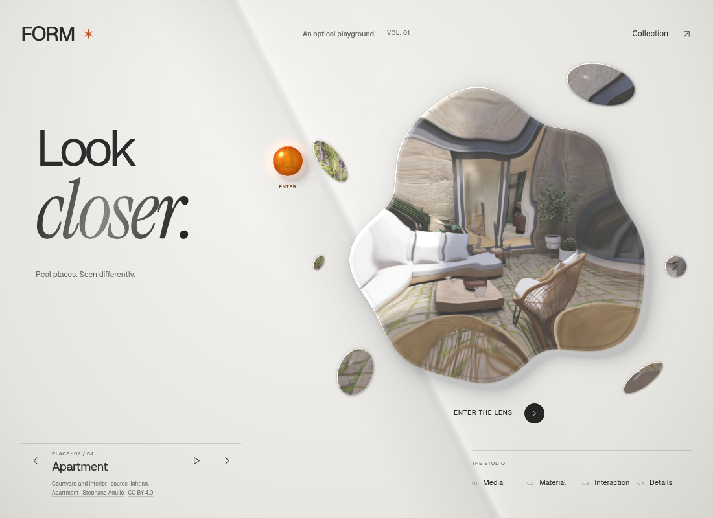
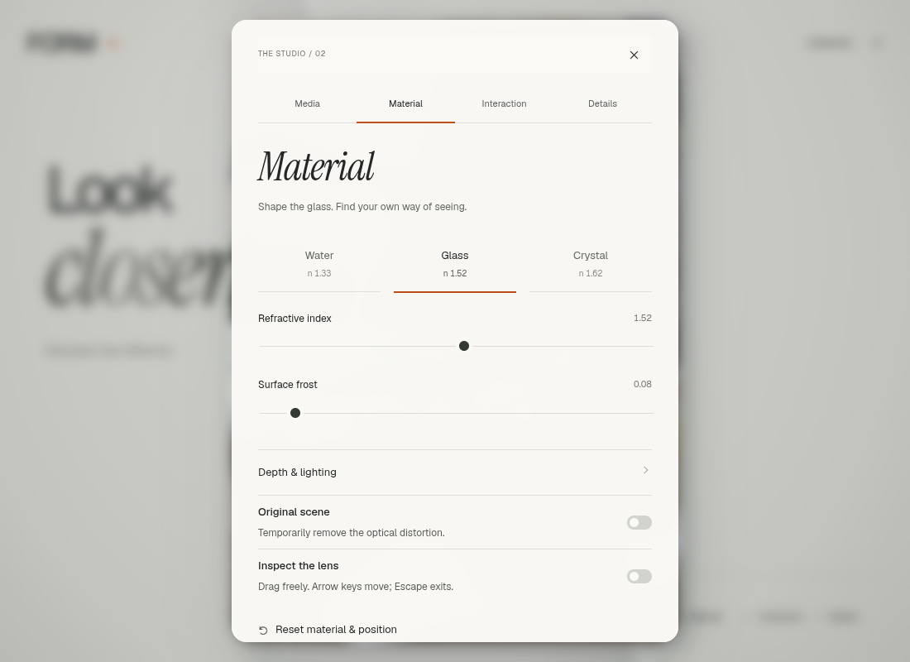
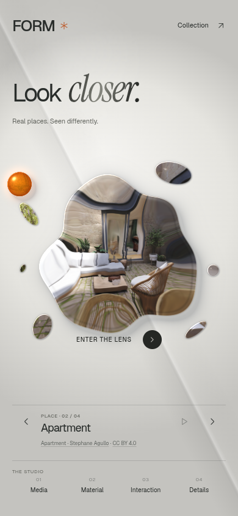
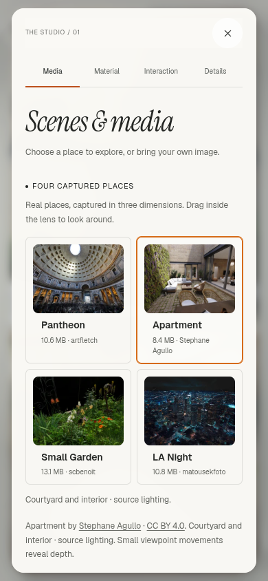

# Look closer — a minimal FORM exhibition

[Open the desktop and phone preview](https://rawcdn.githack.com/ejaubashi/vvv/91d68539bd0c92cf9ba6b37775b9977573587275/preview/index.html?room=1&space=apartment&renderer=webgl).

The entrance now pairs a restrained Geist “Look” with the expressive italic “closer.” in Instrument Serif. Shorter copy, a compact FORM mark, fine footer rules and generous spacing give the optical artwork more attention. The phone uses the same phrase on one line. Collection access sits in the header on both screen sizes.

Hovering or keyboard-focusing a studio section changes the introductory line to its purpose: “Discover a place,” “Shape the light,” “Find your rhythm,” or “Behind the surface.” Leaving the navigation restores the introduction. Touch opens the section directly. These descriptions also belong to the buttons' accessible semantics. Each change uses an owned, cancelable 280 ms native effect; rapid selection never delays the actual content change.

Inside the studio, italic headings, unboxed material choices, thin slider tracks and a moving selection underline replace the heavier controls. Sliders retain 44 px input targets. Pause and depth-navigation symbols use SVG so their meaning does not depend on font glyph coverage.

The accepted splash silhouette, six unequal fragments, shared room image, glass edges, shadows and amber sun remain intact. Entry still merges the pieces into the room and return restores them. This release adds no graphics dependency or persistent animation loop.

## Type and access

Geist variable and Instrument Serif italic are self-hosted, unmodified Latin WOFF2 files from Fontsource 5.3.0, totaling **51,528 bytes**. Original SIL Open Font License notices and file hashes are recorded in [font provenance](../public/fonts/PROVENANCE.json). The build emits only this pair; older source font files remain historical.

The existing finite title and section animations support keyboard and touch, system and application reduced motion, forced colors, interrupted transitions and browsers without the Web Animations API. Reduced motion settles active effects immediately. No delayed text replacement or duplicate form state is introduced.

## Verification

The strict TypeScript/production build and formatting checks pass. Fifteen focused browser flows pass across section navigation, media, optical controls, idle rendering, entry/return, WebGL, WebGPU and reduced motion. A final four-case motion recheck also passes; it repeats the motion subset after the last underline/forced-colors polish rather than adding four unique flows.

Fifty-six production layout checks cover all four sections, two home states and nine viewport sizes, plus font fallback and forced colors. They verify contained content, non-overlapping controls, usable close controls, touch targets and the absence of the former circular frame. These layout-isolation checks use Canvas and the room illustration fallback. Separately, the real Apartment capture is reviewed at desktop and phone sizes with the optical WebGL context and ready Spark scene explicitly verified. Native section effects, purpose previews, Collection focus restoration, room entry and both reduced-motion paths are checked in the built site.

The production website has 30 files totaling 47,234,750 bytes, including the lazily loaded captured collection. The single-file export is 61,529,096 bytes and loads both embedded fonts without external requests. Both production reviews record no page errors, external application requests or failing responses. See the [validation and publication record](minimal-exhibition-validation-results.json). Browser checks use software Chromium; physical-device frame rates and Safari/Firefox remain unverified. Delivery verification compares the published GitHub blobs with the exact reviewed build because the execution proxy blocks the GitHack endpoint.

