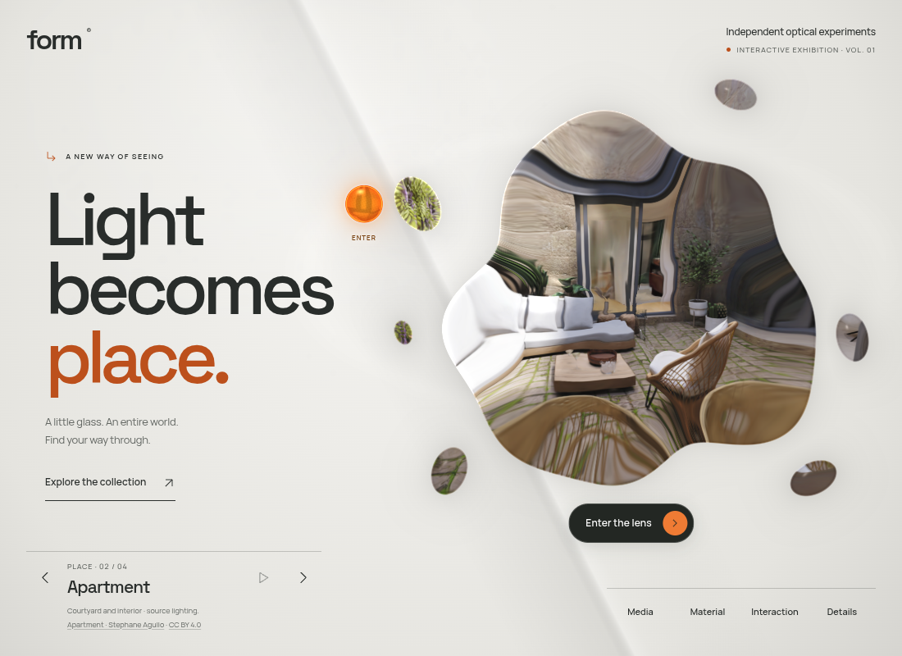
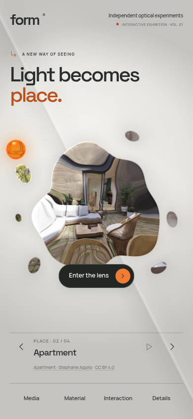

# One image, through a splash of glass

The lens is a liquid silhouette with one larger body and six detached glass droplets. They reveal one shared room or media frame in a common coordinate system. A droplet at the upper right shows the upper-right portion of that frame, rather than repeating a complete miniature image. The gaps reveal the ordinary backdrop.

The current fit enlarges the splash by about a quarter at typical desktop and phone sizes, with smaller increases on short screens and more room on large displays. Height and width both bound the scale. The decorative circular frame, ticks, and surrounding labels have been removed. Keyboard focus uses temporary corner marks only. On narrow phones the sun rests higher and its duplicate visible label is omitted so it stays clear of the droplets; its accessible name and both entry controls remain available. The first layout settles immediately at its clamped home position.

The room still renders once. There are no extra cameras, scene downloads, media players, or per-piece textures. The shared scene sample is refracted through the body and droplets. Each droplet has its own smaller curvature profile; the main body's irregular edge shapes its normal and rim. These are screen-space optical approximations, as with the original lens, rather than physical fluid simulation.

[Try the larger splash preview](https://rawcdn.githack.com/ejaubashi/vvv/7680a2849be4995fe10f28bfea777360611ece04/preview/index.html?room=1&space=apartment&renderer=webgl).

## Rendering and interaction

`src/render/splash.ts` defines the common body profile and six ellipse islands. It generates equivalent WebGL and WebGPU field functions and the SVG outline used for Canvas clipping and the native button hit area. All pieces are parts of the same lens control. Empty spaces between pieces do not intercept clicks. Keyboard access and a visible focus frame remain available.

During entry, the shrinking shape amount lets the islands merge into the expanding room. Studio panels and the expanded room retain their rectangular surfaces. Returning restores the splash. Material inspection moves the entire composition together. The silhouette is steady at rest; it adds no idle animation loop and follows the existing reduced-motion behavior.

The Canvas fallback clips a single image through the same islands, with its existing simpler magnification and rim treatment. It does not claim equivalent per-piece optical refraction. The bounded optical pass retains the same padded rendering region. Captured-scene provenance, attribution, and source coverage remain unchanged.

## Verification

Three new browser cases verify the central requirement: WebGL and Canvas pixel checks confirm seven sample points correspond to different regions of the same gradient frame, while a gap retains the background. Native hit testing confirms the body and six droplets are one usable control and the empty gap stays open; keyboard actions remain available.

The current fit is checked with 19 production layouts across nine viewport sizes, eight focused browser cases, and three existing entrance unit cases. The built Apartment courtyard is reviewed on desktop and phone, including shape merging and exact shape-state restoration after return. See [the fit validation record](splash-fit-validation-results.json). The initial splash release's broader checks remain historical in [its original validation record](splash-validation-results.json). Automated graphics checks use software Chromium; physical-device frame time is unmeasured.

The [preceding exhibition research](EXHIBITION-RESEARCH.md) explains the surrounding composition. That earlier preview and its layout record remain historical. The splash changes the optical mask while retaining the exhibition's layout.

