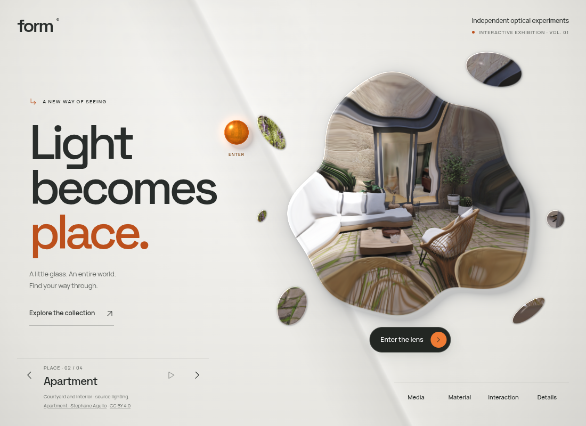
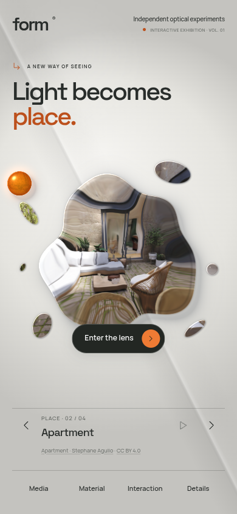

# One image, through a splash of glass

The lens is a liquid silhouette with one larger body and six detached glass droplets. The detached pieces have a deliberate hierarchy: a broad upper-right island, a medium pebble, a slender sliver, a diagonal streak, a round bead, and a tiny speck. Their areas span almost twenty to one, with distinct proportions and rotations. They reveal one shared room or media frame in a common coordinate system. A droplet at the upper right shows the upper-right portion of that frame, rather than repeating a complete miniature image. The gaps reveal the ordinary backdrop.

The current fit enlarges the splash by about a quarter at typical desktop and phone sizes, with smaller increases on short screens and more room on large displays. Height and width both bound the scale. The decorative circular frame, ticks, and surrounding labels have been removed. Keyboard focus uses temporary corner marks only. On narrow phones the sun rests higher and its duplicate visible label is omitted so it stays clear of the droplets; its accessible name and both entry controls remain available. The first layout settles immediately at its clamped home position.

The room still renders once. There are no extra cameras, scene downloads, media players, or per-piece textures. The shared scene sample is refracted through the body and droplets. Each droplet has its own smaller curvature profile; the main body's irregular edge shapes its normal and rim. These are screen-space optical approximations, as with the original lens, rather than physical fluid simulation.

[Try the glass depth preview](https://rawcdn.githack.com/ejaubashi/vvv/c103629322b7c7f37173f9399a65beff2421c7dc/preview/index.html?room=1&space=apartment&renderer=webgl).

The current [instrument exhibition](INSTRUMENT-EXHIBITION.md) pairs bold variable type with a vertical studio index, direct scene selection and a dark panel. Its [motion system](EXHIBITION-MOTION.md) retains masked titles, moving section indicators, and interruptible studio reveals.

## Rendering and interaction

`src/render/splash.ts` defines the common body profile and six ellipse islands. It generates equivalent WebGL and WebGPU field functions and the SVG outline used for Canvas clipping and the native button hit area. All pieces are parts of the same lens control. Empty spaces between pieces do not intercept clicks. Keyboard access and a visible focus frame remain available.

During entry, the shrinking shape amount lets the islands merge into the expanding room. Studio panels and the expanded room retain their rectangular surfaces. Returning restores the splash. Material inspection moves the entire composition together. The silhouette is steady at rest; it adds no idle animation loop and follows the existing reduced-motion behavior.

The Canvas fallback clips a single image through the same islands, with its existing simpler magnification and rim treatment. It does not claim equivalent per-piece optical refraction. The bounded optical pass retains the same padded rendering region. Captured-scene provenance, attribution, and source coverage remain unchanged.

## Glass depth and light

The current surface treatment gives the main lens and every fragment a scaled bevel, a fine bright edge, an inner absorption band, and a soft cast shadow. Screen derivatives of the distance field provide contour normals, so highlights follow each fragment rather than the center of the whole composition. The existing Material light-direction control moves the reflections and shadows together. Bevel width is bounded in CSS pixels to keep tiny pieces readable on phones.

Each primitive projects and softens its own shadow before their opacities are combined. This avoids a sharp seam where the nearest surface changes from the large body to a small droplet. A restrained transmitted-light accent sits near the opposite edge. Shadows fade away during room immersion. These are screen-space material approximations, not ray-traced transmission or volumetric glass.

The orange sun has a spherical reflection, a Fresnel rim, static amber inclusions, a soft directional shadow, and a smaller warm glow. Its normal follows the entrance stretch and rotation while its illumination stays aligned with the material light. Hover no longer draws a separate circular ring around its larger invisible hit target.

WebGL and WebGPU implement the same treatment in the existing bounded optical pass. Shadow work runs only in the exterior perimeter band; it adds no full-screen blur, render target, texture download, dependency, or idle animation. Canvas uses cached contours, per-fragment gradient bevels and scaled shadows, plus a simpler illuminated amber sphere. It retains its simpler refraction and does not claim pixel-equivalent GPU shading.

## Verification

Three existing browser cases verify the central requirement: WebGL and Canvas pixel checks confirm seven sample points correspond to different regions of the same gradient frame, while a gap retains the background. Native hit testing confirms the body and six droplets are one usable control and the empty gap stays open; keyboard actions remain available.

The current material treatment is checked with 11 browser cases, including WebGPU shader validation, directional highlight and shadow pixels in WebGL and Canvas, neutral material, smooth shadow falloff in gaps, shared-image sampling, and entry/return behavior. Nine production layout checks cover desktop, phone, short-phone, landscape and font fallback; the offline export loads its two embedded fonts without external requests. The real courtyard is reviewed on desktop and phone with the optical WebGL context explicitly verified. See [the surface validation record](glass-depth-validation-results.json). The earlier [fragment](splash-fragments-validation-results.json), [fit](splash-fit-validation-results.json), and [initial splash](splash-validation-results.json) checks remain historical. Automated graphics checks use software Chromium; physical-device frame time is unmeasured.

The [preceding exhibition research](EXHIBITION-RESEARCH.md) explains the surrounding composition. That earlier preview and its layout record remain historical. The splash changes the optical mask while retaining the exhibition's layout.

