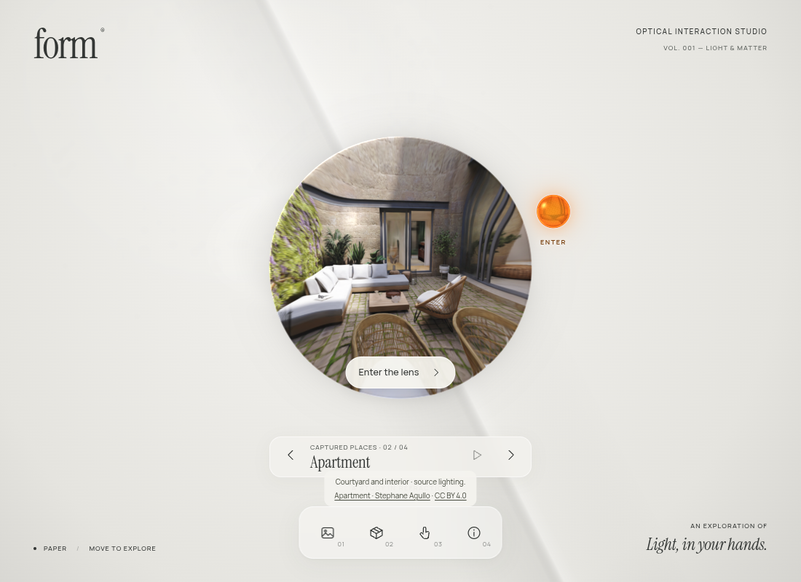
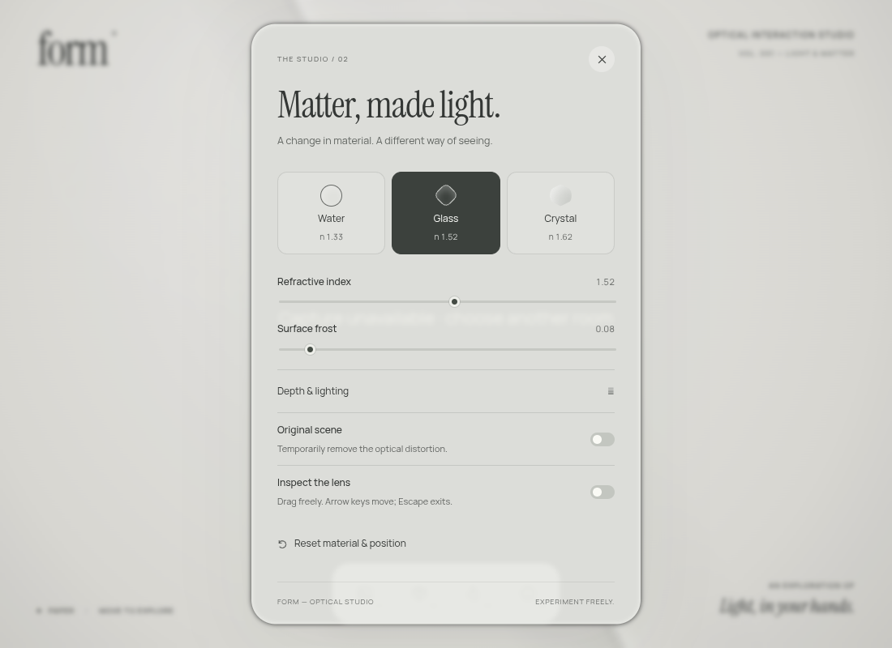
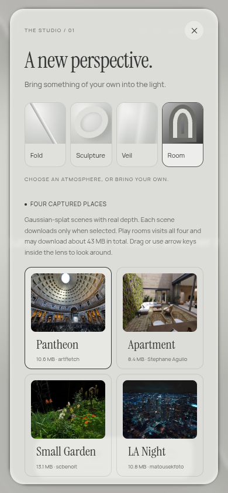

# FORM typography

Instrument Serif gives the wordmark, studio headings, room names, and media cards a warmer architectural character beside the solar-orange glass. Its italic cut sets the short line “Light, in your hands.” Manrope handles controls, descriptions, credits, and technical labels, with tabular numerals for changing values.

The smallest labels increase to 9px, with a shared scale for captions, body copy, and controls. Heading spacing and room navigation widths accommodate the new letterforms. On narrow room views, decorative footer text gives way to the room navigation and creator credits.

[Open the typography preview](https://rawcdn.githack.com/ejaubashi/vvv/7bcf3798114e806976a41a82405e7add2edb5f61/preview/index.html?room=1&space=apartment&renderer=webgl).

## Font delivery

Three original Latin WOFF2 files total 67,996 bytes. The site hosts them itself, preloads the two regular faces, and uses `font-display: swap` with system fallbacks. No external font service or runtime dependency is added. The standalone exporter embeds all three files so the portable artwork keeps the same typography without network requests.

Manrope and Instrument Serif are distributed under the SIL Open Font License 1.1. Package versions, original filenames, sizes, and SHA-256 hashes are recorded in [font provenance](../public/fonts/PROVENANCE.json). Full notices accompany the deployment and are embedded in the standalone export through [third-party licenses](../public/THIRD-PARTY-LICENSES.txt).

## Verification

The production build and standalone export pass. Six existing browser regression cases cover entrance, return, touch, reduced motion, studio controls, focus containment, resizing, and WebGPU presentation. A separate production review checks 25 layouts across desktop, mobile, narrow portrait, and landscape sizes, including all four studio panels, blocked-font fallback, and the offline edition. All three font faces load; the offline edition makes zero external asset requests. A final production screenshot checks the real Apartment capture through the WebGL lens.

The [validation record](typography-validation-results.json) records this update. Broader original entrance results remain historical; they were not all rerun for the font change.

