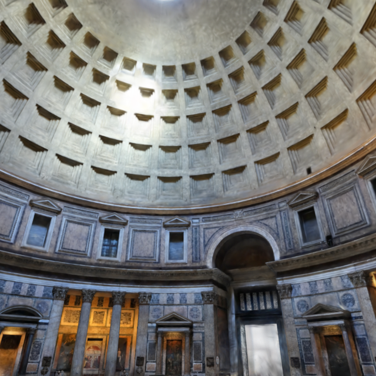
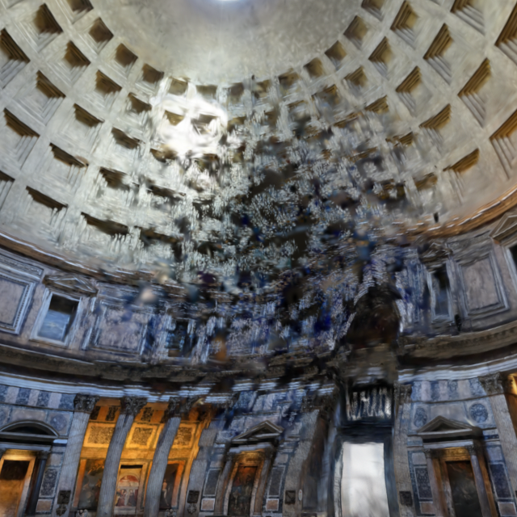

# Unravel the room

The captured Pantheon can now be sculpted while inside the lens. This is an
artistic deformation of the existing 700,000 Gaussian splats, not a rigid-body
fracture simulation or a newly captured state of the building.

## Experience

1. Open `?room=1&space=pantheon&renderer=webgl` and choose **Enter the lens**.
2. Enable **Unravel the room**. Normal view navigation stays available when the
   mode is off.
3. Hold on a part of the room. Clusters of splats detach into a local suspended
   current; dragging gives that current direction. The surrounding architecture
   provides a stable reference.
4. Release. A staggered spring recovery leaves a short fading trace, then restores
   the original capture. No transformed positions are written back into the asset.

For keyboard use, enabling the mode focuses the room. Hold **Space**, use the
**arrow keys** to bend the flow, and release Space to restore. **Escape** first
returns to looking; another Escape returns to the resting lens. The control is
unavailable with system or application reduced motion; deliberate view navigation
continues to work.

Opening Studio, changing rooms, returning to the lens, or enabling reduced motion
cancels the deformation. Blur, hidden tabs, pointer cancellation and lost pointer
capture release/cancel held input. Hidden pages do not keep a held gesture running.
The mode control hides while Studio is open, keeping the mobile dock accessible.

## Implementation

- `src/room/unravel.ts` owns the explicit mode, gesture anchor, hold state, flow and
  finite recovery. Three additional springs live in the existing `Motion` spring
  collection. The shared application clock advances all of them; no independent
  animation loop or timer is introduced.
- `src/room/unravel-shader.ts` builds a Spark Dyno **world modifier**. It projects
  original world-space splat centers into the current camera to find a soft brush
  region. Deterministic 0.65-unit world cells share drift offsets, retaining local
  coherence; contracted splat scales reveal gaps between moving clusters. Captured
  colors, orientations and lighting are retained.
- Hold amount, time, brush, flow and camera basis are GPU uniforms. The renderer
  regenerates and sorts the deformed splats through Spark; pointer events do not
  iterate through the 700,000 points on the CPU. Splat positions are derived from
  the original data every time. The modifier copies its input unchanged when the
  amount is exactly zero, so recovery has no cumulative geometric error.
- The captured room continues to use the same renderer, lazy asset download,
  origin-clean portal canvas and PNG export path. Opening Studio restores the room
  before using its existing export control. Async sorting wakes the existing
  clock. While held, a small periodic drift keeps the suspended material alive;
  after recovery, the deformation stops scheduling frames.
- This is not semantic stone segmentation, collision geometry or physical relighting.
  Splats cannot reveal missing captured surfaces. It remains the hybrid Pantheon
  reconstruction described in `CAPTURED-REALITY.md`, including the reconstructed
  floor. The source SOG is unchanged, with the same pinned digest and CC BY 4.0
  attribution. Runtime deformation is an additional display modification.

The implementation follows Spark's documented modifier mechanism:
<https://github.com/sparkjsdev/spark/blob/main/examples/splat-dissolve-effects/index.html>
and <https://github.com/sparkjsdev/spark/blob/main/docs/docs/dyno-overview.md>.
It adds no runtime dependency beyond the already installed Spark 2.4.0 and Three
r186. The optional capture chunk grows by about 57 KB minified / 11 KB gzip.

## Validation

Focused unit tests cover deliberate activation, bounded flow, camera independence,
continuous regrabbing, finite recovery, cancellation and reduced motion. Browser
input checks use actual pointer, touch and keyboard events. A separate real-capture
GPU test renders a deformed frame, verifies a substantial pixel change, then
verifies that the reconstructed frame at a fixed camera is **byte-identical** to
  the baseline PNG.
The full-app check exercises the mode control, reduced-motion gate, keyboard hold,
Escape, Studio cancellation and return to the lens.

Chromium/SwiftShader checks establish behavior and shader correctness, not hardware
frame-rate claims. Physical mobile/desktop GPUs and Safari/Firefox remain unmeasured.

## Visual checkpoints

| Original | Held and dragged |
| --- | --- |
|  |  |

These fixed-camera GPU checkpoints use **The Pantheon Interior** by artfletch,
<https://superspl.at/scene/dac6e508>, licensed under
[CC BY 4.0](https://creativecommons.org/licenses/by/4.0/). The right image applies
FORM's reversible runtime deformation. The restored checkpoint exactly matches the
left image. These are screenshots of the real capture renderer, not generated
illustrations or alternate scene assets.

Release record, 2026-10-22: production build and 23 unit tests passed. All 48 browser
cases passed (47 in the full run, plus the existing capture panel case rerun after
aligning its software-GPU wait to 30 seconds). The nested production path and the
18,257,399-byte portable edition passed, with zero external asset requests from the
portable file and zero browser errors. See `unravel-validation-results.json`.
